# aniML World

Physically simulated animals that learn to move from motion capture–style reference
animation, trained with adversarial imitation learning in NVIDIA Isaac Lab. The long-term
target is an ecosystem simulation in Unity 6 where every animal's body is driven by a
learned controller rather than canned animation.

The project has two halves. The animals: the first species is a deer, a 38-joint
articulated body with full self-collision, trained with Adversarial Motion Priors (AMP) and
then Adversarial Skill Embeddings (ASE). The world: a procedurally generated island in
Unity 6, built from simulated geological and hydrological processes rather than painted
terrain.

<p align="center">
  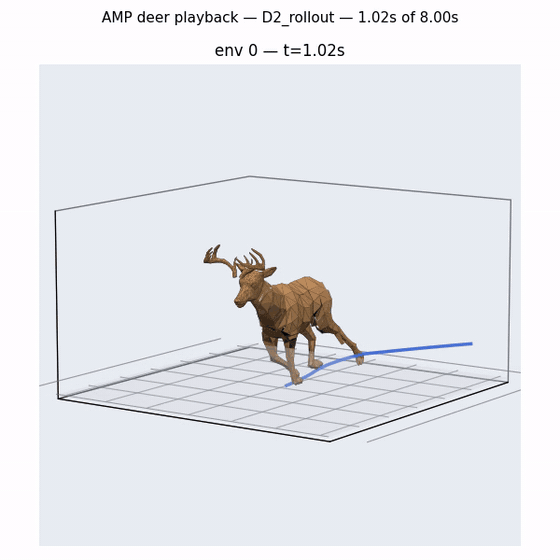
</p>

<p align="center"><em>A learned trot. No keyframes at runtime: every joint is torque-driven
by a policy trained against the reference animation below.</em></p>

<p align="center">
  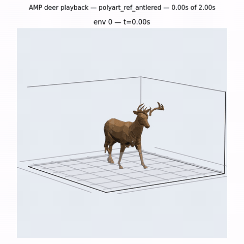
</p>

## Progress

The first few months were mostly about getting a simulated deer to stay on its feet at
all. These are from an earlier rig, before the current 38-joint build:

<table>
  <tr>
    <td align="center" width="25%" valign="top"><b>Can't get up</b><br>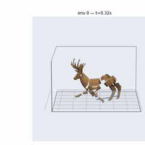<br><sub>Chest on the ground, legs splayed, never rises</sub></td>
    <td align="center" width="25%" valign="top"><b>Falls over</b><br>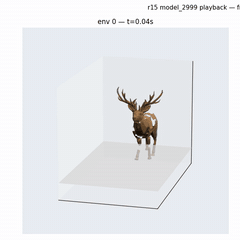<br><sub>Stands for a moment, collapses within two seconds</sub></td>
    <td align="center" width="25%" valign="top"><b>Stands up the wrong way</b><br>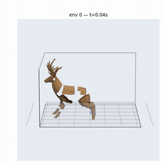<br><sub>Gets off the ground by rearing onto its hind legs</sub></td>
    <td align="center" width="25%" valign="top"><b>Upright, stiff-legged</b><br>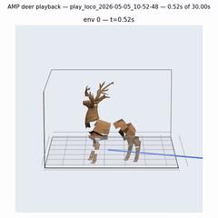<br><sub>Stays up, but shuffles on locked, splayed legs</sub></td>
  </tr>
</table>


Getting from there to a gait took a rebuilt rig and a few dozen more training runs. Four
points along the way on the current rig:

<table>
  <tr>
    <td align="center" width="25%" valign="top"><b>Early</b><br>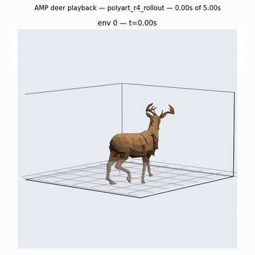<br><sub>Scrambles forward in a crouch</sub></td>
    <td align="center" width="25%" valign="top"><b>Collapse</b><br>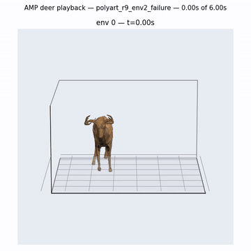<br><sub>Pitches onto its head</sub></td>
    <td align="center" width="25%" valign="top"><b>Upright, no gait</b><br>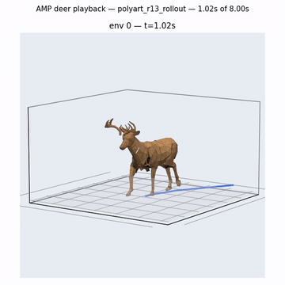<br><sub>Balances, but shuffles instead of stepping</sub></td>
    <td align="center" width="25%" valign="top"><b>Trotting</b><br>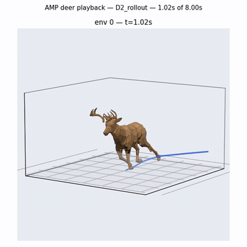<br><sub>Sequential footfalls, steady rhythm, holds a straight line</sub></td>
  </tr>
</table>


Most of the distance between the second and fourth columns was not reward tuning. It was
finding and fixing problems in the rig and the reference data that the training metrics
could not see (see [What went wrong](#what-went-wrong-and-what-fixed-it)).

## How it works

```
Malbers deer (FBX)
  -> Blender, headless: build a 38-DOF URDF from the skinned mesh
  -> Blender, headless: extract joint-angle reference clips, validated by FK round-trip
  -> URDF -> USD, collision filtering, preflight checks
  -> Isaac Lab (PhysX, 4096 parallel envs): AMP, then ASE
  -> ONNX -> Unity 6 Sentis   (planned)
```

**Rig.** The URDF is generated from the skinned model rather than hand-built, so joint
axes come from the same bone motion the reference clips are extracted from. The extractor
reconstructs every link position from the extracted angles and compares it to the source
animation; a wrong axis convention shows up as centimetres of error instead of a subtly
wrong gait.

**AMP.** A discriminator scores state transitions against the reference clips, and its
output becomes a style reward blended with a velocity-tracking task reward. The reward set
was deliberately cut down to the task terms plus a few safety terms; hand-shaped gait
rewards (air time, joint-range targets) each produced a distinct pathology and were
removed.

**ASE.** Stage 1 trains a policy conditioned on a random latent `z` on the unit sphere, with
an encoder rewarded for recovering `z` from the motion. I also implemented the paper's
diversity objective, which needed a hook inside rsl_rl's PPO update that the library does
not expose. Measured with a phase-aligned z-sweep, it increased skill separation by about
12% at matched training length without reducing the encoder's mutual information.

<p align="center">
  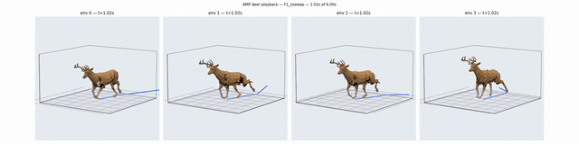
</p>
<p align="center"><em>ASE stage 1: four copies of the same policy, each pinned to a
different latent.</em></p>

## What went wrong, and what fixed it

The recurring lesson was that a training curve can look healthy while the animal is doing
something wrong. Each of these was invisible in TensorBoard and found by measuring the
right thing directly, often after watching a render.

- **The reference clip was 58% frozen frames.** The style reward was teaching the policy
  to stand still. Fixed by trimming to the real keyframe range and checking velocity
  histograms of every clip before training.
- **About a million newtons of phantom self-collision** on an 809 N animal, from helper
  links that defeated PhysX's parent-child collision filtering. Found by comparing total
  contact force to body weight.
- **Mirrored hind-leg collision meshes.** The render looked perfect; the hooves had no
  contact geometry.
- **A "walk" clip that was two-thirds turning.** It was three takes chained together, two
  of them deliberate turns. Net yaw cancelled out, so a net-turn check passed it. The
  policy that trained on it veered.
- **Two of three reference clips were 1.25x oversized,** from a Blender version change that
  scales FBX imports. Joint angles are scale-invariant, so nothing looked wrong, but the
  root velocities the discriminator saw were 25% too fast. Caught by forward-kinematics
  checking that the lowest hoof actually reaches the ground.
- **Adding observations made the gait worse.** Giving the discriminator hoof height and
  hoof speed made it more confident and the style reward weaker, and foot slip got
  steadily worse with each channel added. In AMP the observation space and the reward
  scale are coupled and have to be tuned together.

The data and rig problems are now checks in `tools/rig_pipeline/preflight.py`, which is run
before every training launch and exits non-zero if any of them fail.

<p align="center">
  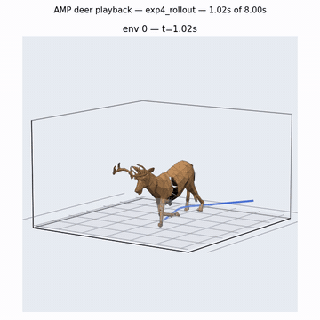
</p>
<p align="center"><em>Not every run went well.</em></p>

## Evaluation

Evaluating a gait from logged rewards turned out to be unreliable, so every policy is
rolled out under a fixed command and scored on measurements of the motion itself:

- **Load share per leg**, from contact forces, to catch legs that swing but carry no weight
- **Hoof slip**: hoof speed while planted, relative to body speed, compared with the reference
- **Ankle contact share**, to catch walking on the pastern instead of the hoof
- **Stride regularity** and **heading drift**
- **Phase-aligned z-sweep separation** for ASE skills

Sixteen policies were re-evaluated under identical conditions. The current best holds a
straight line (no measurable heading drift) with regular stride timing at around 3 m/s.

## Current limitations

- The deer lands on the front of the ankle rather than the hoof on three legs.
- Every policy trots well and walks slowly badly; slow, near-static gaits are still open.
- Command tracking is loose: several policies settle at their own preferred speed.

## The world

The island the animals will live on is generated, not authored. Each seed runs a pipeline
of physical processes, roughly in the order they would act on real terrain:

- **Landmass**: domain-warped fractal noise with ridged mountain masks and an island
  falloff. Each seed rolls a landmass shape: a single island, a crescent with a deep bay,
  a peninsula, or twin isles separated by a strait.
- **Erosion**: about 37,000 simulated droplets of hydraulic erosion carve dendritic
  tributaries and sediment fans, followed by thermal erosion that settles slopes to a talus
  angle. Rock hardness damps both, so mesas and crags stay sharp.
- **Water**: rivers are traced from flow accumulation, with monotonic carved beds,
  meanders and oxbows on lowlands, and waterfalls where they drop. Lakes are found with a
  priority-flood pass, so standing water exists exactly where the terrain would hold it.
- **Geology**: glacial carving into U-shaped valleys with moraines above a paleo-snowline,
  wind-transverse dune fields, fault scarps, karst, sea stacks, and caves.
- **Climate and life**: moisture from distance to fresh water, temperature from latitude
  and altitude, rain shadows behind ranges, and biome-driven vegetation scatter from those
  fields.
- **Landmarks**: one of each, sited where the terrain singles them out: a waterfall at the
  biggest drop on any river, a giant tree in a clearing of the largest forest, a red-rock arch on the
  canyon rim, a cave in a mossy cliff face, hot springs, a whale skeleton on a beach.
- **Profiles**: one set of dials produces coherent variants from the same seed, including
  temperate isles, alpine granite, canyonlands, a swampy delta and a volcanic island with
  a lava flow routed down the real terrain gradient. Within a profile, each seed also rolls
  its own recipe: river and forest counts, canyon depth, whether there is a fault, and
  which optional landmarks appear.

The world also reacts at runtime: weather wets and darkens the ground, snowlines move,
there are seasons and a day-night cycle, and wildfire can spread. Ambient life (raptors,
songbirds, bats, fireflies, butterflies) follows biome and time-of-day rules. The terrain
and water shaders are custom; the environment art uses Synty's POLYGON packs, which are licensed and not included here.

**Built for the animals.** The island is where the animals will live, so it is checked for
what matters to an animal, not just for how it looks. At generation time a flood fill on a
4 m grid (passable means slope under 38° and water under half a metre) reports how much of
the land is reachable and how much of that forms one connected region. Rivers get fords:
gravel bars that rise to just under an unchanged water surface. The canyon gets one
crossing, a ramp cut down both walls where the rims are lowest. The same terrain also
answers the questions the ecosystem sim will ask: `SampleBrowse01` (forage, richest at
forest edges and in moist meadows, suppressed by cold, bare rock, burn scars and ash),
`SampleCover01` (concealment from forest, crags and marsh) and `SampleWaterAccess01`
(reach to drinkable water).

**Checked by render.** As with the deer, the numbers were not enough on their own. Every
change is baked headless and reviewed as renders of fixed views plus a camera on every
landmark. Some things only showed up that way:

- Hydraulic erosion left small pits that the lake pass dutifully filled, so ponds perched
  on hillsides. Pits are now filled, and a basin only becomes a lake if it is broad
  relative to its depth.
- Rivers sourced from flow accumulation started inside closed summit bowls, cut an exit
  trench through the rim, and the lake pass then flooded the bowl, drowning the alpine
  forest. A source must now drain to the sea on the flow graph.
- The same change moved the biggest drop on any river, and with it the waterfall, onto
  the coastline, where it poured into open sea.
- An asset pack's "Rock_Cliff" meshes turned out to be glacier ice with a refractive
  shader, so the granite massif rendered as blue crystals.
- Color grading silently does nothing in headless captures. Three rounds of "graded"
  comparison renders differed only in fog. Grades are now compared in image space and
  the difference is checked numerically before anyone judges it.

**Reproducible and reversible.** The same seed and profile always build the same world.
Each major generation feature (per-seed recipes, landmass shapes, connectivity,
flow-derived rivers) has a switch on the `WorldSettings` asset and landed as its own
commit, so any one of them can be turned off or reverted without touching the others.

<!-- World screenshots go here: docs/media/world_*.png -->

## Next

The Malbers pack ships about 60 animation takes and the deer currently uses three. Next
is a behaviour model (grazing, drinking, idle variants, turns, reactions) built as ASE
stage 2 on top of the locomotion controller, then exporting the policy to Unity so the deer
runs on the generated island.

## Stack

Isaac Sim 5.1 and Isaac Lab, PhysX on GPU, PyTorch, rsl_rl and amp-rsl-rl, Blender 5.1
(headless Python) for rig and reference extraction, Unity 6 and Sentis for deployment.
Trained on a single RTX 5080.

## Repository layout

```
training/polyart/        environment config, rewards, observations, ASE
training/scripts/        training entry point (AMP / ASE patches on amp-rsl-rl)
tools/rig_pipeline/      URDF build, reference extraction, preflight, gait analysis
tools/                   evaluation and rendering
unity/aniML-world/       Unity 6 project: world generation, shaders, runtime systems
experiments/launch/      the exact configuration of every training run
docs/                    write-ups of individual findings
archive/                 earlier plans and session logs
```

## Assets

The deer model and animations come from the Malbers Animations Forest Pack, and the
environment art from Synty's POLYGON packs. Both are paid assets and are not redistributed
here, and neither is anything generated from them (rig meshes, USD files, extracted motion
clips). The pipeline expects a local copy of the deer pack; the path is set in
`configs/species/deer_polyart.json`.
